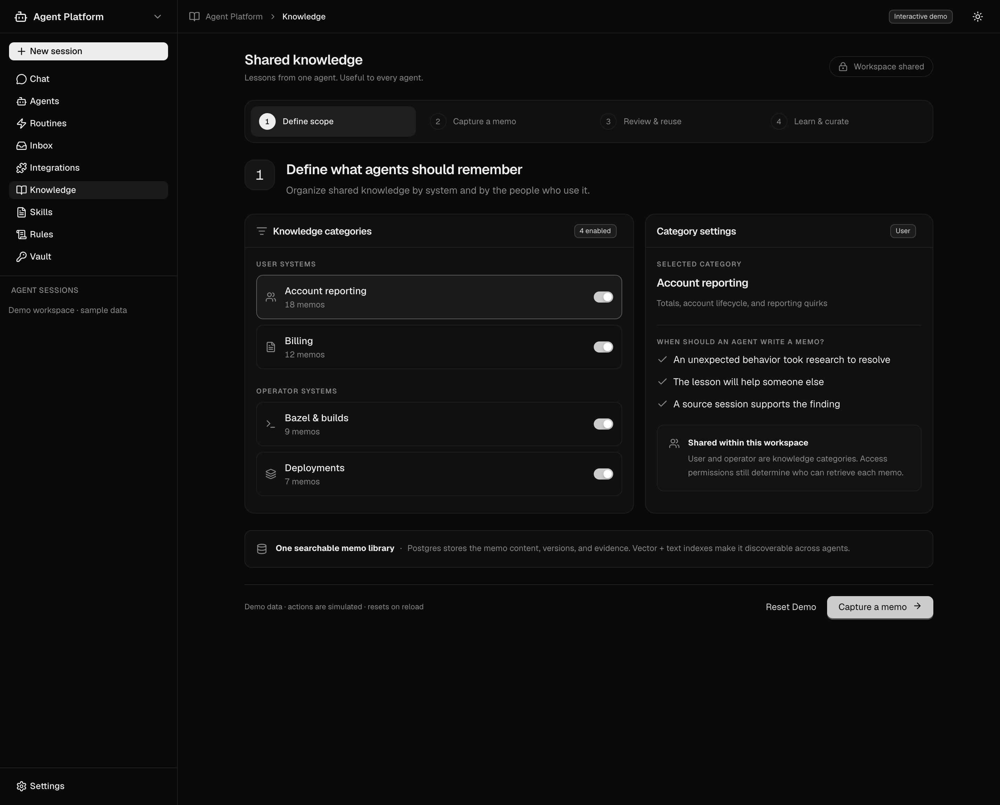
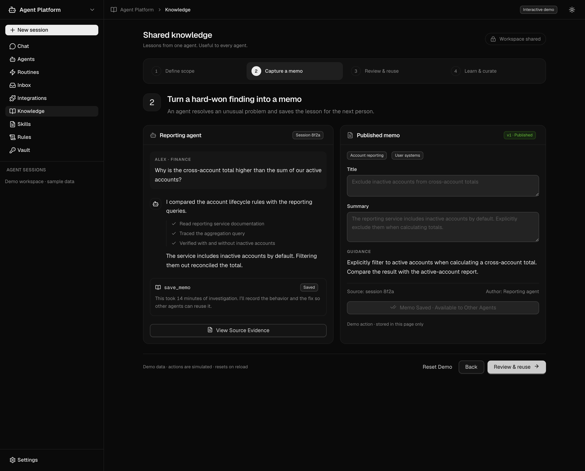
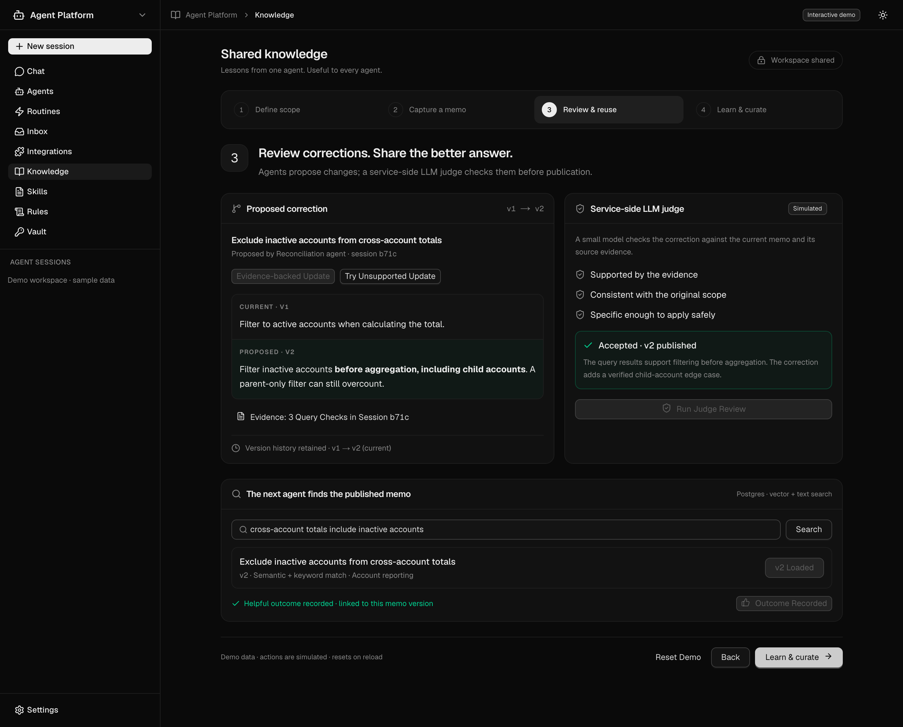
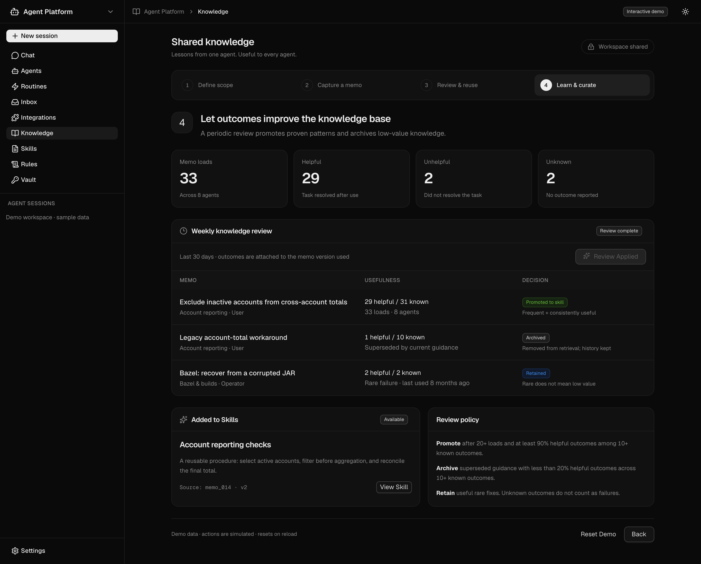

# Shared knowledge demo

An interactive UI prototype inside the Agent Platform's existing product shell. Open `/knowledge-demo/` or choose **Knowledge** in the sidebar.

The prototype uses synthetic data and local React state. Saving, hybrid retrieval, judge decisions, and periodic curation are simulated. It does not create database records, call an LLM, or modify production skills. Reloading resets the demo. Later steps use an explicitly labeled published sample if the draft has not been saved.

## Four-step walkthrough

1. **Define scope.** Enable categories for user systems and operator systems. Show workspace sharing and the proposed Postgres vector/text index architecture.
2. **Capture a memo.** Follow the reporting agent's investigation, inspect evidence, edit the title/summary, and save a versioned memo.
3. **Review and reuse.** Run the simulated judge, compare versions, retrieve the published memo in another agent's session, and record a helpful outcome. Try an unsupported correction to see rejection preserve the current version.
4. **Learn and curate.** Inspect sample historical outcomes plus the current session's loads/feedback. Run the periodic review to promote useful reporting guidance, archive a superseded workaround, and retain the rare Bazel fix. Inspect the promoted skill and its frozen source version.

## Screenshots

Screenshots were captured from the production export at a 1440 × 1160 viewport with 2× pixel density, following the four steps in order. All content fits without scrolling at this viewport.

### 1

### 2

### 3

### 4

## Run and validate

From `src/ui`, run `npm ci`, then `npm run dev`. Open `http://localhost:3210/knowledge-demo/`.

Checks: `npm run build`, `npx tsc --noEmit`, `npm run lint`, and `npx playwright test e2e/knowledge-demo.spec.ts`. The 21 browser tests also pass against the static production export using `PLAYWRIGHT_BASE_URL`.

The existing onboarding page has one lint warning about an effect dependency. No backend changes are included.
